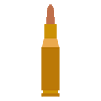
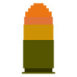
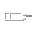
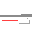
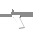
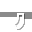
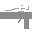
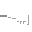
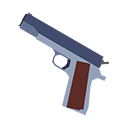
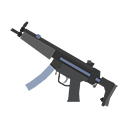

# 自定义枪械永续创造栏图标 | CGC creative tab icons

[中文](#自定义枪械永续创造栏图标) | [English](#cgc-creative-tab-icons)

# 自定义枪械永续创造栏图标

为[自定义枪械永续](https://github.com/XColorful/Custom-Gun-Continued)添加默认的创造栏图标。
- 支持 Minecraft 1.20.1+ 任意版本 Forge/NeoForge

---

`该模组需要安装在服务端和客户端`

## 使用说明

### 前置模组

- 自定义枪械永续（≥ 26.10.32）
	- [CurseForge](https://www.curseforge.com/minecraft/mc-mods/custom-gun-continued) | [Modrinth](https://modrinth.com/mod/custom-gun-continued) | [Github Releases](https://github.com/XColorful/Custom-Gun-Continued/releases)

### 安装方式

枪包支持两种安装方式：
- `.jar`：服务端和客户端安装`customgun-tab-pack.jar`
- `数据包`+`资源包`：服务端安装数据包`customgun-tab-pack-datapack.zip`，客户端安装资源包`customgun-tab-pack-resourcepack.zip`

## 图标

|子弹|爆弹|
|---|---|
|||

|枪口|激光指示器|握把|弹匣|瞄具|枪托|
|---|---|---|---|---|---|
|||||||

| | | |
|---|---|---|
| 手枪| 突击步枪| 精确射手步枪|
| 狙击步枪| 霰弹枪| 冲锋枪|
| RPG| 自定义||

## 许可证

- 资产：[CC-BY-SA-4.0](https://creativecommons.org/licenses/by-sa/4.0/)

# CGC creative tab icons

Add default creative tab icons for [Custom Gun Continued](https://github.com/XColorful/Custom-Gun-Continued).
- Supports any Forge/NeoForge version for Minecraft 1.20.1+

---

`This mod needs to be installed on both the server and the client.`

## Usage Instructions

### Prerequisites

- Custom Gun Continued (≥ 26.10.32)
	- [CurseForge](https://www.curseforge.com/minecraft/mc-mods/custom-gun-continued) | [Modrinth](https://modrinth.com/mod/custom-gun-continued) | [Github Releases](https://github.com/XColorful/Custom-Gun-Continued/releases)

### Installation

The gun pack supports two installation methods:
- `.jar`: Install `customgun-tab-pack.jar` on both the server and the client.
- `Data Pack` + `Resource Pack`: Install the data pack `customgun-tab-pack-datapack.zip` on the server and the resource pack `customgun-tab-pack-resourcepack.zip` on the client.

## Icons

|Ammo|Explosive|
|---|---|
|||

|Muzzle|Laser|Grip|Magazine|Scope|Stock|
|---|---|---|---|---|---|
|||||||

| | | |
|---|---|---|
| Pistol| Assault Rifle| Designated Marksman Rifle|
| Sniper Rifle| Shotgun| Submachine Gun|
| RPG| Custom||

## License

- Assets: [CC-BY-SA-4.0](https://creativecommons.org/licenses/by-sa/4.0/)
